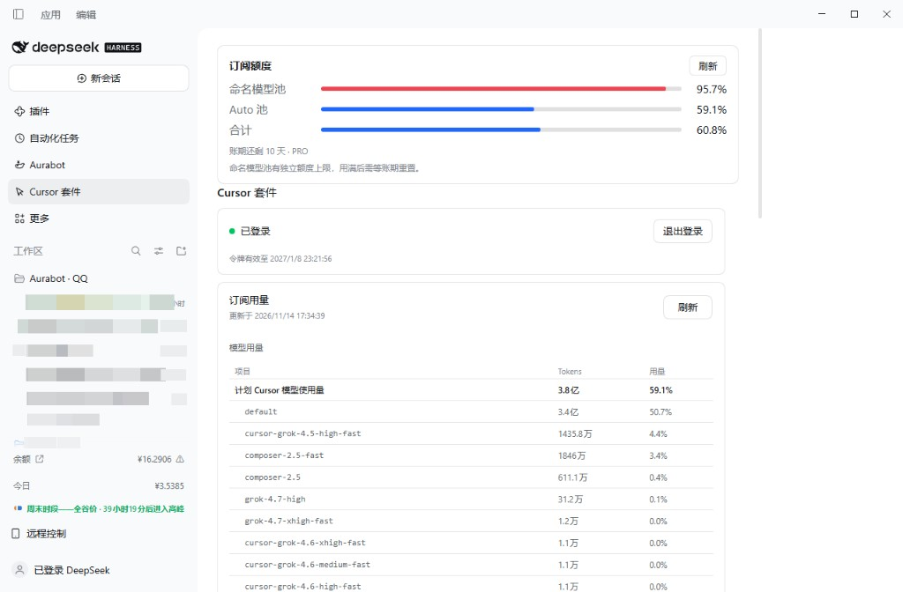
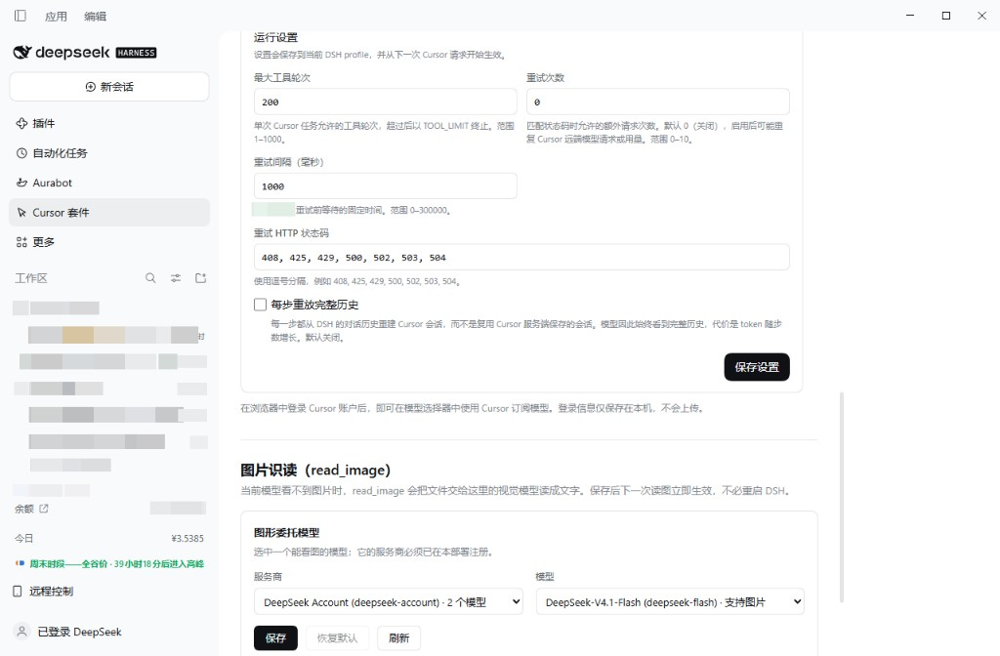

# dsh-cursor-suite

**English** | [简体中文](README_zh.md)

One DeepSeek Harness plugin that ships two halves together:

1. **Cursor subscription provider** — browser PKCE sign-in, model discovery, streaming Agent protocol, DSH tools instead of Cursor-native execs.
2. **`read_image` vision bridge** — when the active route (including Cursor) cannot see pixels, forwards the file to a vision-capable subagent and returns text.

> ⚠️ The Cursor half talks to Cursor’s unpublished Agent protocol (`agent.v1.AgentService/Run`). It is community reverse-engineering and may break when Cursor changes servers. Not affiliated with Anysphere or Cursor. Follow Cursor’s terms of service.

## Features

- Sign in with a Cursor account (no API key); credentials live in DSH’s store with automatic refresh.
- Model picker lists usable Cursor models; when the named/API pool is ≥95% used, the catalog keeps only **Auto** and stale named selections are remapped to Auto.
- Streams text and reasoning; DSH tools run locally. Native Cursor Shell/Read/Grep/… execs are declined with the same wording as [dsh-cursor-subscription](https://github.com/orrinzeng/dsh-cursor-subscription).
- Stream end matches upstream subscription: wait for `turnEnded` (checkpoint alone does not finish an answer step).
- Replaces the built-in `read_image` so image tools work on routes that advertise image input but drop pixels (Cursor).
- Settings page under **Settings → Cursor Suite** (namespace `cursor-suite`): sign-in, usage, models, tool-round / retry / replay options.

## Screenshots

**Subscription quota, sign-in status, and per-model usage**



**Runtime limits / retries, and `read_image` vision delegation**



## Installation

### Plugin Market (dshmarket)

After this package is listed in [awesome-dsh-plugin](https://github.com/awesome-dsh-plugin/awesome-dsh-plugin), install it from **Plugins → Plugin Market** as `dsh-cursor-suite`, or:

```sh
dsh plugin --profile desktop add github:Dream-swift/dsh-cursor-suite
```

Restart DSH after install. Do **not** install `dsh-cursor-subscription` or a separate read-image bridge in the same profile — this suite already includes both.

### From GitHub (manual)

```sh
dsh plugin --profile desktop add github:Dream-swift/dsh-cursor-suite
dsh plugin --profile desktop list dsh-cursor-suite --depth 0
```

pnpm may skip a release younger than 24 hours (`minimumReleaseAge`). Pin a version or exempt the package name in the profile’s `pnpm-workspace.yaml`.

### Local development

In the profile directory (e.g. `%USERPROFILE%\.dsh\profiles\desktop`):

```sh
pnpm add file:G:/DeepSeek_Sandbox/qqbot/_repo/dsh-cursor-suite
```

Add `dsh-cursor-suite` to `dsh.profile.bundles` in that profile’s `package.json`, then restart DSH.

## Sign-in and usage

1. Open **Settings → Cursor Suite**.
2. Choose **Browser Sign-in** and finish the Cursor OAuth flow.
3. Pick a Cursor model (or Auto) in the session model picker.
4. When the agent needs files or a shell, it should use DSH tools (`pwsh`, `read`, `grep`, …), not Cursor-native Shell.

Vision: when the model calls `read_image` under Cursor, the bridge may call a vision route (default `deepseek-account` / `deepseek-flash`). Configure the bridge under its own settings file `~/.dsh/read-image-bridge.json` if needed.

## Updating and removing

```sh
dsh plugin --profile desktop update dsh-cursor-suite
dsh plugin --profile desktop remove dsh-cursor-suite
```

Restart DSH after update or removal.

## Relationship to dsh-cursor-subscription

| | `dsh-cursor-subscription` | `dsh-cursor-suite` |
|--|--|--|
| Cursor provider | Yes | Yes (same protocol family) |
| `read_image` bridge | No | Yes |
| Settings namespace | `cursor-subscription` | `cursor-suite` |
| Bundle row id | `cursor-subscription` | `cursor-suite` |

Use **one** of them per profile.

## Troubleshooting

- **Still signed out after browser login:** Finish the redirect page; polling waits ~2.5 minutes.
- **Empty model list:** Discovery can fail by account type; fallback models still accept a manual id.
- **401:** Re-sign-in when refresh tokens expire.
- **`patch: entry "cursor-suite" not found` / peer mismatch:** Install a build whose `peerDependencies` match your DSH (0.2.0-rc line).
- **Images ignored on Cursor:** Confirm this suite is loaded and built-in `tool-fs.readImage` is off via the bundle patch.

## License

[MIT](LICENSE)
